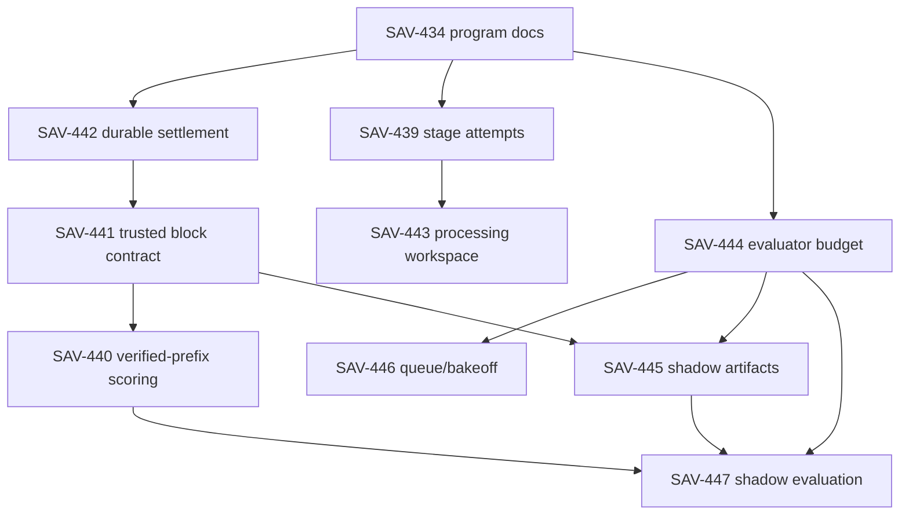

# Interview-To-Feedback Delivery Program

Status: accepted delivery architecture for SAV-433

Decision authority:
[Durable Interview-To-Feedback Loop](../decisions/2026-08-13-durable-interview-to-feedback-loop.md)

## Outcome

Meelni should turn an ended PM interview into trustworthy feedback quickly,
without allowing transport races or an unverified terminal tail to erase useful
evidence. This program preserves the canonical transcript and final batch
evaluation as authorities while improving settlement durability, score
granularity, latency, observability, and the processing experience.

The four phases are a dependency-gated merge train, not four independent
rewrites. Each phase must remain compatible with rows and events produced by
the previous phase and must land through PR-sized Linear children.

## Baseline and remaining gaps

The current system already has a strong server-owned spine:

1. `POST /api/interview/end` records `ending/user_end` and a cutoff.
2. `interview/end.requested` starts an idempotent Inngest finalizer.
3. The finalizer requests a writer-scoped runtime settlement, freezes canonical
   evidence, commits terminal truth, dispatches feedback, schedules cleanup,
   and settles credit at separate durable checkpoints.
4. Feedback claims a fenced generation, derives answer blocks from frozen
   evidence, invokes a closed-schema evaluator, validates the result, and
   persists one authoritative outcome.

The program closes these remaining structural gaps:

| Boundary             | Current strength                                              | Remaining gap                                                                 |
| -------------------- | ------------------------------------------------------------- | ----------------------------------------------------------------------------- |
| End acceptance       | Fast, owner-scoped, replay-safe, recoverable                  | The runtime settlement request itself is not a durable database command       |
| Runtime settlement   | Writer-scoped acknowledgement and bounded wait                | Packet delivery and active participant discovery can race disconnect/shutdown |
| Evidence             | Canonical events, frozen cutoff, derived answer blocks        | Session-wide partial state constrains independently trusted closed blocks     |
| Evaluation           | Closed provider schema, fenced generation, grounded citations | No single deadline/retry budget or attempt-level stage history                |
| Candidate experience | Typed lifecycle polling and terminal outcomes                 | Processing is mostly waiting rather than a useful saved-review workspace      |
| Incremental work     | Batch evaluation remains authoritative                        | No safe shadow artifact contract for measuring earlier evaluation             |

## Target flow

```mermaid
flowchart LR
  A["End accepted"] --> B["Commit cutoff + writer generation + settlement command"]
  B --> C["Fast packet wake-up hint"]
  B --> D["Runtime command discovery"]
  C --> E["Drain canonical writes through cutoff"]
  D --> E
  E --> F["Durable writer acknowledgement"]
  B --> G["Bounded finalizer wait"]
  F --> G
  G --> H["Freeze classified canonical snapshot"]
  H --> I["Derive trusted closed answer blocks"]
  I --> J["Dispatch authoritative batch evaluation"]
  J --> K["Budgeted evaluator attempts"]
  K --> L["Validate and persist feedback"]
  L --> M["Present scorecard or typed scoreless outcome"]
  I -. "default-off only" .-> N["Versioned shadow block artifacts"]
  N -.-> O["Compare with batch authority"]
```



The browser observes durable state throughout this flow. It does not own
settlement, infer completeness, schedule provider work, or repair terminal
truth.

## Cross-phase invariants

- Canonical persisted transcript events remain citation and integrity truth.
- End acceptance never depends on the browser staying mounted.
- A packet may accelerate work but cannot be the only representation of work.
- Every command, acknowledgement, generation claim, and evaluation artifact is
  idempotent and fenced against stale writers or events.
- Only trusted closed candidate blocks can support evaluation.
- Every customer scorecard contains every weighted dimension score and the
  stored canonical total. Incomplete numerical coverage reduces to scoreless
  coaching; no consumer synthesizes or renormalizes a total.
- No session duration, turn count, provider prose, or unverified tail can
  manufacture evidence.
- Candidate markers, canonicalization failures, gaps, degraded writers,
  malformed boundaries, and post-cutoff events remain fail-closed.
- Operational telemetry contains no user identity, session identifier,
  transcript text, feedback text, provider payload, or credential.
- Default-off or shadow means no customer-visible, insights, billing, or
  authoritative-feedback side effect.
- Production/default-on action, provider spend, live calibration, migrations in
  Production, and launch decisions remain explicit human-owner gates.

## Phase 1: durable settlement and observable progress

Linear parent: SAV-436

### Runtime-settlement command

End acceptance owns a database transaction that records:

- the session and lifecycle version;
- the immutable semantic cutoff;
- the targeted writer generation;
- a versioned command identity and state;
- creation, bounded expiry, acknowledgement, and terminal classification
  timestamps; and
- closed, content-free reasons for acknowledgement, expiry, fencing, or
  degradation.

The exact schema is implementation-owned, but it must support an additive
forward migration, one logical command per accepted end version, replay-safe
reads, and a service-only mutation boundary. The existing LiveKit settlement
request payload should be derived from the durable command rather than becoming
an alternate authority.

The Python agent checks for settlement work when it receives the packet hint
and when it handles explicit end, participant disconnect, and process/session
shutdown. It drains through the recorded cutoff and acknowledges the same
writer generation. A stale agent may not acknowledge a replacement writer's
command.

The finalizer waits within its existing bounded settlement stage. An expired or
unavailable acknowledgement freezes a typed partial/degraded/missing snapshot
from persisted watermarks; it never silently upgrades evidence.

### Feedback stage history

The operational model must preserve attempts instead of only a latest duration.
The minimum allowlisted dimensions are:

- release/environment class;
- stage: end acceptance, settlement command, runtime acknowledgement,
  terminalization, dispatch, queue claim, evidence preparation, provider,
  validation, persistence;
- attempt number and bounded duration bucket;
- outcome: succeeded, deferred, skipped, failed, fenced;
- closed reason/failure class; and
- declared SLO boundary where applicable.

Stage history may be implemented through operations events and aggregate
queries; it does not require storing customer content.

### Processing workspace

Once end acceptance is durable, the feedback page should render:

- confirmation that the interview is saved;
- the canonical transcript or answer evidence already permitted by current
  visibility contracts;
- a small durable stage description and leave/return behavior; and
- terminal recovery or unavailable actions when the bounded state requires it.

It must not expose internal error codes, claim unsupported timing precision, or
start a second preview evaluator.

PR-sized children:

- SAV-442 — durable runtime-settlement command;
- SAV-439 — stage attempts and provider failure classes;
- SAV-443 — useful processing workspace.

## Phase 2: verified-prefix scoring

Linear parent: SAV-435

### Separate session state from block authority

The frozen evidence projection must preserve enough canonical boundaries to
classify each derived answer block. A block is trusted for numerical evidence
only when all of these predicates hold:

```text
committed
AND gap-free
AND prompt-bound
AND cutoff-safe
AND healthy writer generation
AND logically closed
AND free of degrading candidate/canonicalization markers
```

Logical closure must be deterministic and based on accepted transcript or
terminal boundaries. It cannot be inferred from elapsed silence alone. The
contract must explain how interviewer follow-up, explicit section/prompt
changes, accepted end, and a terminal preserving interviewer marker close or
limit a block.

### Evaluation policy

| Frozen evidence                                                                                            | Trusted blocks                      | Allowed authoritative result                                                     |
| ---------------------------------------------------------------------------------------------------------- | ----------------------------------- | -------------------------------------------------------------------------------- |
| Complete and healthy                                                                                       | One or more                         | Existing full, partial, or coaching policy                                       |
| Partial only because the terminal interviewer tail is unverified                                           | Earlier trusted closed blocks exist | Dimension coverage over those blocks; sparse scores allowed; overall always null |
| Partial with no trusted closed candidate block                                                             | None                                | Scoreless coaching or no-reviewable outcome under existing policy                |
| Candidate marker, gap, degraded writer, canonicalization failure, malformed boundary, post-cutoff conflict | Any affected block                  | Fail closed; no score inferred from affected evidence                            |

The batch evaluator remains the sole source of authoritative feedback. The
server continues to validate closed facet selections and reconstruct citations
from canonical events.

PR-sized children:

- SAV-441 — trusted closed answer-block authority and OpenSpec contract;
- SAV-440 — verified-prefix partial scorecards and compatibility tests.

Implementation status (2026-08-14): the additive verified-prefix slice keeps
the existing batch evaluator and answer-block grouper, binds partial numerical
results to the ordered SAV-441 trusted projection, withholds overall scores,
and revalidates the projection at every authenticated downstream action. The
historical v1 path and its focused-practice fingerprints retain their exact
pre-prefix projections; no existing row is rewritten.

## Phase 3: end-to-end latency budget

Linear parent: SAV-437

### Budget and retries

One deadline begins when the feedback generation event is accepted or claimed
and is propagated through evidence preparation, provider execution, response
validation, and persistence. Nested work must expire before its caller. A retry
may start only when the failure is transient and enough budget remains for a
complete attempt.

The failure taxonomy must at least distinguish:

- transient transport timeout or connection failure;
- provider rate/capacity limitation;
- permanent authentication/configuration failure;
- invalid or unsupported provider response;
- transcript/evidence integrity failure;
- stale or fenced generation work; and
- internal persistence/constraint failure.

Retry count alone is not a policy. The implementation records attempt start,
remaining budget, duration, outcome, and closed failure class without raw
provider or interview content.

### Provider-free bakeoff and queue policy

The evaluation harness should measure prompt tokens, maximum output tokens,
schema validity, deterministic parser compatibility, simulated latency, and
estimated cost across candidate model/tier configurations using sanitized
fixtures. Any live paid comparison requires explicit owner authorization.

Queue and concurrency settings must be derived from the latency budget and
capacity evidence. They should avoid a global throttle that turns a short model
call into a long queue while still protecting duplicate work and spend.

PR-sized children:

- SAV-444 — end-to-end deadline and typed retry policy;
- SAV-446 — provider-free bakeoff and queue policy.

## Phase 4: incremental shadow evaluation

Linear parent: SAV-438

This phase starts only after Phase 2 defines trusted closure and Phase 3 owns
provider budgets. It does not put incremental feedback in the product.

Each shadow artifact identity must bind at least:

```text
session
+ trusted answer-block fingerprint
+ rubric version
+ prompt version
+ selection schema version
+ model version
```

The stored artifact is additive and non-authoritative. Only the same trusted
closure seam used by Phase 2 may schedule it. Reconnects, event replay, worker
crashes, and equivalent transcript segmentation must not duplicate physical
work or change authoritative batch feedback.

When final batch feedback is available, a content-free comparison reports
facet/mode/score agreement, missing artifacts, failure class, post-freeze
potential lead, token counts, and estimated cost. Timing is unavailable for
missing/failed artifacts or mismatched terminal anchors. Disagreement has no
candidate or insights side effect.

PR-sized children:

- SAV-445 — versioned shadow artifact and default-off storage contract;
- SAV-447 — shadow evaluator and comparison with batch authority.

Implementation status (2026-08-14): the artifact/storage slice adds a strict
content-minimized key/value/set contract and a separate immutable service-only
table behind an opaque default-off write context. It does not schedule work,
invoke a provider, participate in feedback lifecycle reads, or affect customer
feedback, progress, insights, or billing. Account export/deletion cover the
artifact; no shorter retention period is inferred.

The execution/comparison slice composes that storage with a second opaque
default-off capability and no registered evaluator/provider adapter. Only a
recomputed terminal SAV-441 projection schedules content-free exact-key work.
Evaluation uses SAV-444 deadlines, deterministic per-key concurrency, deletion
fences, and immutable writes. Batch comparison waits at most the 90-second
evaluation-policy horizon using bounded durable polls, then returns only a
strict aggregate report. It does not persist through or emit to customer
feedback, insights, progress, billing, UI, or interview ownership. Because no
pre-terminal authority exists, this slice measures only post-freeze potential
and cannot establish true during-interview savings.

## Merge train and task ownership

SAV-434, this documentation slice, merges first. The following lanes may then
work in parallel, but a child may merge only after every named dependency is on
`main`:



Phase parents close only after their children are merged and the phase
acceptance criteria are verified. SAV-433 closes only after all four phase
parents are complete. A merge is not a Production rollout authorization.

## Proposed targets and evidence gates

The shipped lifecycle document currently records feedback completion targets
of p95 under 45 seconds and p99 under 90 seconds. This program proposes tighter
targets; they are not shipped SLOs or launch evidence until implementation and
isolated-staging measurements support them.

| Measure                                                               | Proposed program target       |
| --------------------------------------------------------------------- | ----------------------------- |
| Runtime settlement acknowledgement or explicit bounded classification | at least 99% of accepted ends |
| Hard transcript degradation attributable to settlement mechanics      | below 1%                      |
| Evaluator success excluding permanent configuration/auth failures     | above 99%                     |
| First useful feedback phase                                           | p50 under 15s; p95 under 30s  |
| Future incremental shadow artifact, if later authorized               | p50 under 5s; p95 under 10s   |

Each implementation PR must include provider-free failure fixtures, targeted
behavior tests, `npm run typecheck`, applicable build checks, and
`npm run verify:agent`. Ready PRs must pass hosted checks. Database or provider
changes require the repository's migration and operations runbooks. Isolated
staging, live providers, Production mutations, paid comparisons, default-on
flags, and launch remain separate owner-authorized steps.

## Likely implementation seams

These paths are orientation, not permission for a broad refactor:

- end and durable finalization: `lib/workflows/accept-user-interview-end.ts`,
  `lib/workflows/durable-user-interview-end.ts`, and
  `lib/inngest/functions/finalize-user-interview-end.ts`;
- settlement request/acknowledgement: `lib/workflows/request-user-end-runtime-settlement.ts`,
  internal transcript routes, agent transcript contracts, and the Python
  LiveKit runtime;
- frozen evidence and answer-block trust: `lib/db/transcripts.ts`,
  `lib/evaluation/session-validator.ts`, and `packages/core/src/answer-blocks.ts`;
- authoritative evaluation: `lib/workflows/generate-feedback.ts`,
  `lib/inngest/functions/generate-feedback.ts`, and dimension-coverage modules;
- presentation: authenticated feedback API/page/view-model contracts; and
- reusable fixtures: `packages/test-fixtures` plus production-shaped workflow
  and database migration fixtures.
