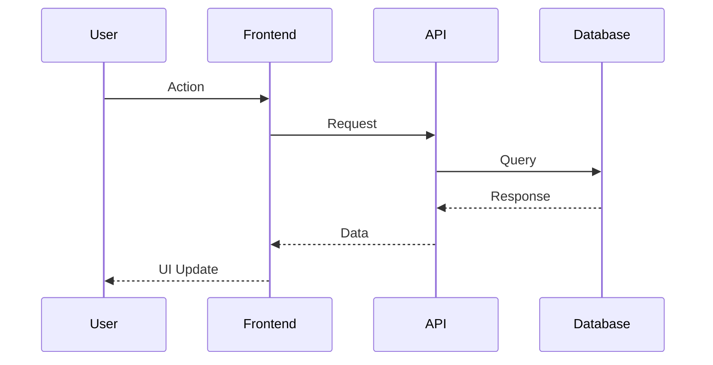

# [Feature Name]

**Status**: [Implemented | In Progress | Planned]
**Last Updated**: YYYY-MM-DD
**Owner**: [Team/Person responsible]

## Overview

Brief description of what this feature does and why it exists (2-3 sentences).

### Key Benefits

- Benefit 1
- Benefit 2
- Benefit 3

### Related ADRs

- [ADR-XXX: Related Decision](../architecture/adrs/ADR-XXX-title.md)
- [ADR-YYY: Another Decision](../architecture/adrs/ADR-YYY-title.md)

## User Flow

Describe the end-to-end user journey with this feature.

### Happy Path

1. User does X
2. System responds with Y
3. User completes Z

### Alternative Flows

- **Error Case**: What happens when...
- **Edge Case**: What happens if...

### Screenshots/Wireframes

(Include if relevant)

## Technical Architecture

### Components

**Frontend**

- `component/path.tsx` - Description
- `component/other.tsx` - Description

**Backend**

- `api/route/path.ts` - Description
- `lib/service.ts` - Description

**Database**

- Tables: `table_name`, `other_table`
- See: `.claude/DATABASE.md` for schema details

### Data Flow

```
User Action → Frontend → API → Database
                ↓
          External Service
```

Or use a mermaid diagram:



### Key Files

| File                | Purpose                       |
| ------------------- | ----------------------------- |
| `/path/to/file.ts`  | Component/service description |
| `/path/to/other.ts` | Another file description      |

## API Endpoints

### `POST /api/feature/action`

**Request**:

```json
{
  "field": "value"
}
```

**Response**:

```json
{
  "success": true,
  "data": {}
}
```

See: `docs/api/endpoint-name.md` for full API documentation

## Configuration

### Environment Variables

```bash
FEATURE_API_KEY=xxx        # Description of what this is
FEATURE_SETTING=value      # Another setting
```

### Feature Flags

- `ENABLE_FEATURE_X` - Toggle this feature on/off

## Database Schema

### Tables Used

**`table_name`**

```sql
CREATE TABLE table_name (
  id uuid PRIMARY KEY,
  field varchar(255),
  created_at timestamp
);
```

### Migrations

- Migration file: `migrations/YYYYMMDD_feature.sql`
- Applied: YYYY-MM-DD

## Testing

### Manual Testing Steps

1. Step 1
2. Step 2
3. Expected result

### Automated Tests

- Unit tests: `path/to/test.spec.ts`
- Integration tests: `path/to/integration.test.ts`
- E2E tests: (if applicable)

### Test Coverage

- [ ] Unit tests pass
- [ ] Integration tests pass
- [ ] E2E tests pass
- [ ] Tested in production-like environment

## Deployment

### Prerequisites

- Dependency 1
- Dependency 2

### Deployment Steps

1. Deploy step 1
2. Deploy step 2
3. Verification step

### Rollback Procedure

If issues arise:

1. Rollback step 1
2. Rollback step 2

## Monitoring & Observability

### Metrics

- Metric 1: What it measures
- Metric 2: What it measures

### Logging

- Key log messages to watch for
- Error patterns to monitor

### Alerts

- Alert condition 1
- Alert condition 2

## Known Issues & Limitations

### Current Limitations

- Limitation 1: Description
- Limitation 2: Description

### Known Bugs

- Bug description ([Link to issue](https://github.com/...))

### Performance Considerations

- Performance note 1
- Performance note 2

## Future Enhancements

### Planned Improvements

- [ ] Enhancement 1
- [ ] Enhancement 2

### Technical Debt

- Technical debt item 1
- Technical debt item 2

## Related Documentation

- **API Docs**: `docs/api/related.md`
- **Integration**: `docs/integrations/service.md`
- **Architecture**: `docs/architecture/adrs/ADR-XXX.md`
- **Troubleshooting**: `.claude/TROUBLESHOOTING.md#feature-section`

## Changelog

### vX.Y.Z (YYYY-MM-DD)

- Change 1
- Change 2

### vX.Y.Z-1 (YYYY-MM-DD)

- Initial implementation

---

**Questions or Issues?**
Contact: [Team/Person] or create an issue on GitHub
