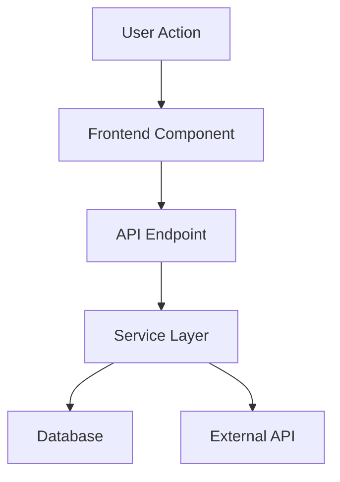

# Implementation Plan

**Sprint**: [Sprint Name]
**Created**: YYYY-MM-DD
**Last Updated**: YYYY-MM-DD

---

## 🎯 Objectives Recap

**What we're building:**
- Objective 1
- Objective 2
- Objective 3

**Why we're building it:**
Brief explanation of the business/technical need.

---

## 🏗️ Technical Approach

### Architecture Overview

**High-Level Design:**
```
[User/Client]
    ↓
[Frontend Component]
    ↓
[API Endpoint]
    ↓
[Business Logic / Service Layer]
    ↓
[Database / External Service]
```

Or use a mermaid diagram:



### Key Components

**Frontend:**
- `app/path/to/page.tsx` - Main page component
- `components/feature/component.tsx` - Feature component
- `lib/hooks/useFeature.ts` - Custom hook (if needed)

**Backend:**
- `app/api/feature/route.ts` - API endpoint
- `lib/services/feature-service.ts` - Business logic
- `lib/db/queries/feature.ts` - Database queries

**Database:**
- Tables: `table_name`, `related_table`
- Indexes: `idx_table_field`
- Constraints: Foreign keys, unique constraints

**External Integrations:**
- Service A: Purpose
- Service B: Purpose

---

## 📊 Database Changes

### New Tables

**`table_name`**
```sql
CREATE TABLE table_name (
  id uuid PRIMARY KEY DEFAULT gen_random_uuid(),
  user_id uuid REFERENCES app_user(id) ON DELETE CASCADE,
  field_name varchar(255) NOT NULL,
  created_at timestamptz DEFAULT now(),
  updated_at timestamptz DEFAULT now()
);
```

**Indexes:**
```sql
CREATE INDEX idx_table_user_id ON table_name(user_id);
CREATE INDEX idx_table_created_at ON table_name(created_at);
```

### Schema Modifications

**Existing Table Updates:**
```sql
ALTER TABLE existing_table ADD COLUMN new_field text;
ALTER TABLE existing_table ADD CONSTRAINT check_field CHECK (field IN ('value1', 'value2'));
```

### RLS Policies

```sql
-- User can only access their own data
CREATE POLICY "Users can only access own records"
  ON table_name
  FOR ALL
  USING (user_id = auth.uid());
```

### Migration Plan

1. Create migration file: `migrations/YYYYMMDD_feature_name.sql`
2. Test migration on local database
3. Run migration on staging
4. Verify RLS policies work correctly
5. Run migration on production

---

## 🔌 API Endpoints

### `POST /api/feature/action`

**Purpose**: Description of what this endpoint does

**Request:**
```typescript
{
  field1: string;
  field2: number;
  field3?: boolean;
}
```

**Response:**
```typescript
{
  success: true;
  data: {
    id: string;
    field1: string;
    created_at: string;
  }
}
```

**Error Responses:**
- `400 Bad Request`: Invalid input
- `401 Unauthorized`: Not authenticated
- `403 Forbidden`: Not authorized
- `500 Internal Server Error`: Server error

**Authentication**: Required (Supabase session)

**Rate Limiting**: X requests per minute

### Additional Endpoints

List other endpoints needed...

---

## 🎨 UI/UX Design

### User Flow

**Happy Path:**
1. User navigates to `/feature`
2. User sees [UI state]
3. User interacts with [component]
4. System responds with [feedback]
5. User completes [goal]

**Error Cases:**
- What happens when API fails?
- What happens when input is invalid?
- What happens when user is offline?

### Component Hierarchy

```
<FeaturePage>
  <FeatureHeader />
  <FeatureContent>
    <FeatureComponent1 />
    <FeatureComponent2 />
  </FeatureContent>
  <FeatureFooter />
</FeaturePage>
```

### State Management

**Client State:**
- UI state: Loading, error, success
- Form state: Field values, validation
- Local preferences: Settings

**Server State (if using React Query):**
- Queries: `useFeatureData`, `useRelatedData`
- Mutations: `useCreateFeature`, `useUpdateFeature`
- Cache invalidation: When to refetch

---

## 🔧 Configuration

### Environment Variables

**Required:**
```bash
FEATURE_API_KEY=xxx              # API key for service X
FEATURE_WEBHOOK_SECRET=xxx       # Webhook signature secret
```

**Optional:**
```bash
FEATURE_ENABLED=true             # Feature flag
FEATURE_RATE_LIMIT=100           # Rate limit per minute
```

### Feature Flags

- `ENABLE_FEATURE_X`: Toggle feature on/off
- `FEATURE_BETA_USERS`: List of beta user IDs

---

## 🔄 Data Flow

### Create Flow

```
1. User submits form
   ↓
2. Frontend validates input
   ↓
3. POST /api/feature/create
   ↓
4. API validates & sanitizes
   ↓
5. Insert into database
   ↓
6. Trigger webhook (if needed)
   ↓
7. Return success response
   ↓
8. Frontend updates UI
   ↓
9. Show success message
```

### Update Flow

Similar to create, but with:
- Check user owns resource
- Validate changes
- Update database
- Invalidate cache

### Delete Flow

- Soft delete vs hard delete?
- Cascade rules
- Cleanup jobs

---

## 🧪 Testing Strategy

### Unit Tests

**Frontend:**
- Component rendering
- User interactions
- State management
- Validation logic

**Backend:**
- API endpoint logic
- Service layer functions
- Database queries
- Input validation

### Integration Tests

- API endpoint → Database flow
- Authentication checks
- RLS policy enforcement
- External API integration

### E2E Tests

- Complete user journey
- Error handling
- Edge cases
- Performance

---

## 🚀 Deployment Plan

### Prerequisites

**Before deploying:**
- [ ] Database migrations tested
- [ ] Environment variables set
- [ ] External services configured
- [ ] Monitoring set up

### Deployment Steps

1. **Staging Deployment**
   - Run database migrations
   - Deploy code
   - Smoke test critical paths
   - Verify monitoring

2. **Production Deployment**
   - Run database migrations (low traffic time)
   - Deploy code
   - Monitor error rates
   - Check performance metrics
   - Verify user flows

### Rollback Plan

**If issues arise:**
1. Revert code deployment
2. Rollback database migration (if safe)
3. Clear caches
4. Notify users (if needed)

---

## 📈 Success Metrics

**KPIs to track:**
- Metric 1: Feature adoption rate
- Metric 2: User engagement
- Metric 3: Error rate
- Metric 4: Performance (P95 latency)

**Monitoring:**
- Application logs
- Error tracking (Sentry)
- Analytics events (PostHog)
- Database queries

**Alerts:**
- Error rate > X%
- Latency > Y ms
- Queue depth > Z

---

## ⚠️ Risks & Mitigation

### Technical Risks

**Risk 1: Database performance**
- **Mitigation**: Add indexes, pagination, caching
- **Fallback**: Rate limiting, read replicas

**Risk 2: External API downtime**
- **Mitigation**: Retry logic, circuit breaker
- **Fallback**: Queue jobs for later

**Risk 3: Data migration errors**
- **Mitigation**: Test on staging, backup before migration
- **Fallback**: Rollback script ready

### Business Risks

**Risk**: User confusion with new feature
- **Mitigation**: Clear UI, onboarding tooltips
- **Fallback**: A/B test, gradual rollout

---

## 🔗 Dependencies

### Internal
- Feature X must be complete
- Database schema Y must exist
- Service Z must be deployed

### External
- API provider: Service name
- Third-party library: Library name
- Infrastructure: Resource name

---

## 📝 Open Questions

**Questions to resolve during implementation:**
- [ ] Question 1: How should we handle edge case X?
- [ ] Question 2: Should we use approach A or B?
- [ ] Question 3: What's the performance impact?

**Decisions needed:**
- [ ] Decision 1: Architecture pattern choice
- [ ] Decision 2: Library/framework selection
- [ ] Decision 3: Data model design

**Research needed:**
- [ ] Research 1: How does competitor do this?
- [ ] Research 2: Best practices for X?
- [ ] Research 3: Security implications?

---

**Plan Status**: [Draft | Reviewed | Approved | In Progress]
**Next Review**: YYYY-MM-DD
